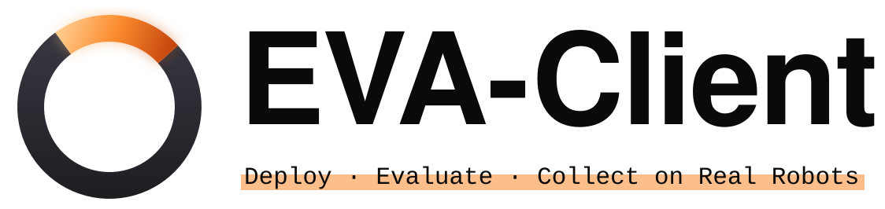
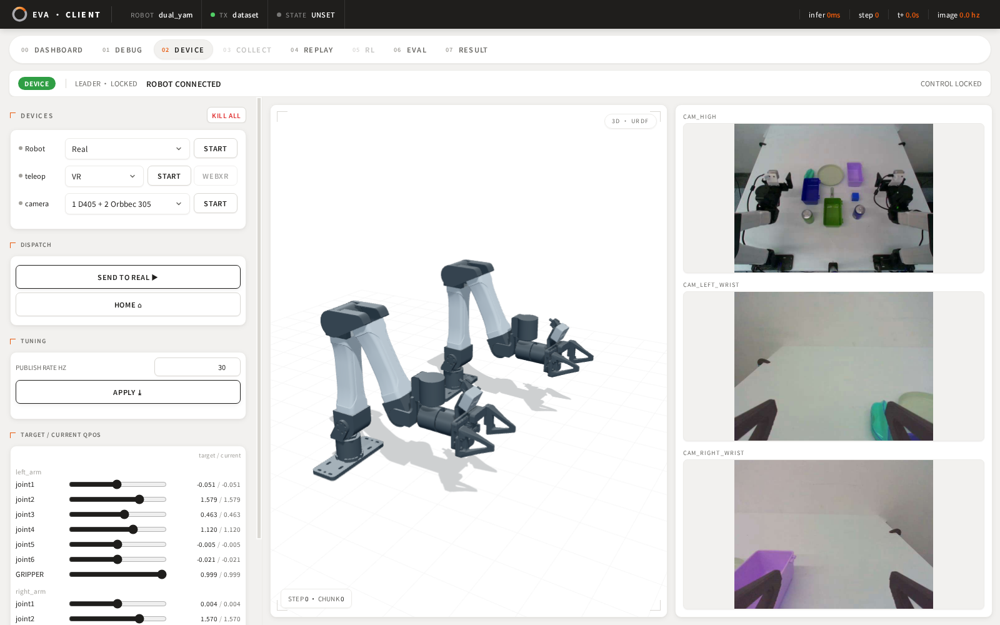
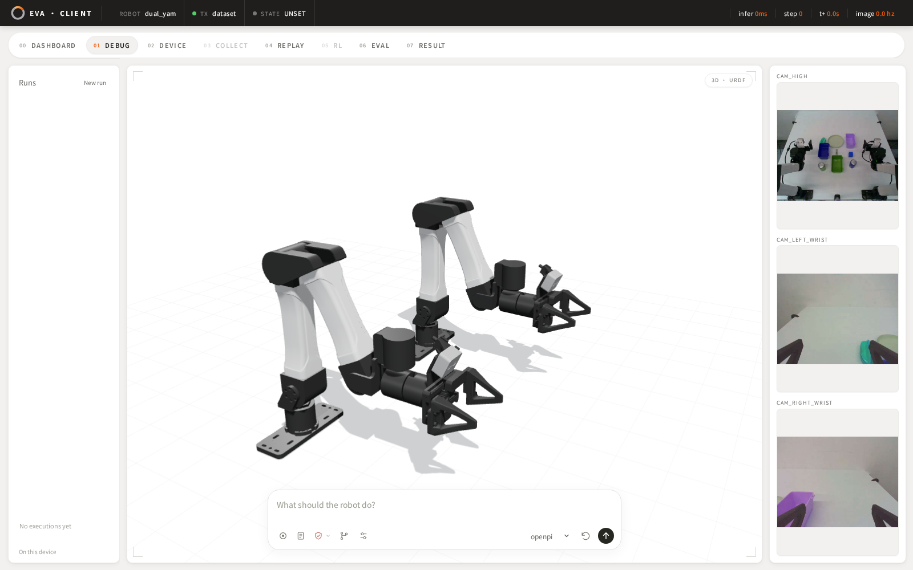
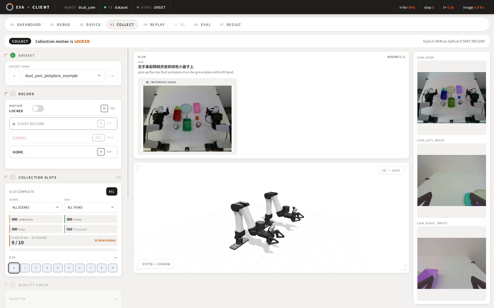
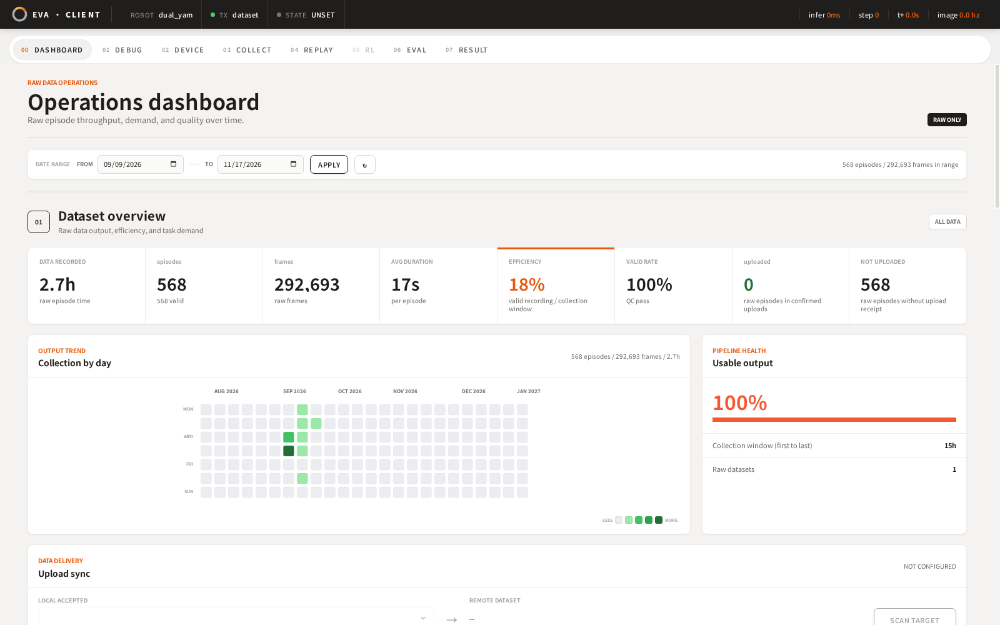
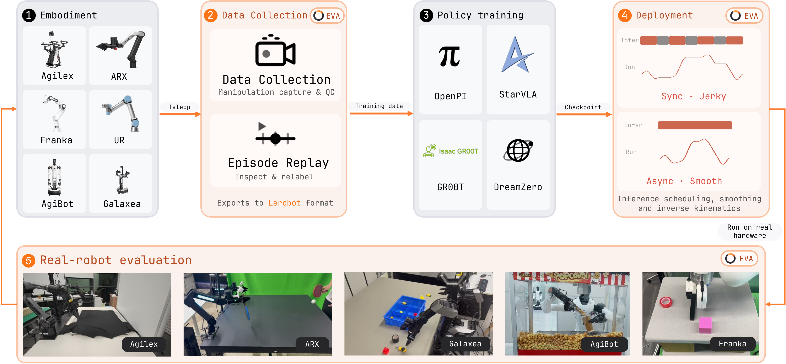

<p align="center">
  <br>
  <a href="https://colalab.net/projects/eva-client/"></a>
  <br>
</p>

<p align="center">
  <a href="README_zh.md">中文</a> &nbsp;｜&nbsp; English
</p>

<p align="center">

<a href="./LICENSE"></a>
<a href="https://arxiv.org/abs/2607.02646"></a>
<a href="https://github.com/Noietch/EVA-CLIENT/pulls"></a>
<a href="https://github.com/Noietch/EVA-CLIENT/stargazers"></a>
<a href="https://colalab.net/projects/eva-client/"></a>
</p>

<p align="center">
<a href="https://colalab.net/projects/eva-client/docs/introduction.html">📖 English Documentation</a> &nbsp;｜&nbsp;
<a href="https://colalab.net/projects/eva-client/docs/introduction.zh.html">📖 中文文档</a> &nbsp;｜&nbsp;
<a href="https://colalab.net/projects/eva-client/paper/EVA_Client_Report.pdf">📄 Technical Report</a> &nbsp;｜&nbsp;
<a href="https://colalab.net/projects/eva-client/">🌐 Project Page</a>
</p>

> ⭐ If EVA-Client helps you, please click the "Star" button in the upper right corner. It keeps us going!

## 📝 Introduction

EVA-Client is a unified framework for **deployment, evaluation, and data collection on real robots**. One policy, any robot: debug, record, evaluate, and visualize, all from a single browser console or headless from the command line.

```bash
git clone https://github.com/Noietch/EVA-CLIENT.git && cd EVA-CLIENT
uv venv --python 3.11 .venv && uv pip install --python .venv/bin/python -e ".[dev]"
.venv/bin/eva --language en   # open http://127.0.0.1:8080
```

<p align="center">
  <video src="https://github.com/user-attachments/assets/09cf8c98-396d-45d0-bd38-8603412ec3c2" controls muted></video>
</p>

<p align="center"><em>EVA-Client driving an AgileX bimanual arm end-to-end from the browser: teleop → record → π₀ checkpoint → smooth async deploy. Real hardware, not a rendering.</em></p>

## ✨ Key Features

- **🚀 One-command Deployment**: A `.py` config brings up a real-robot closed loop: transport ([ROS 1](https://github.com/ros/ros) / [ROS 2](https://github.com/ros2/ros2) / [ZeroMQ](https://github.com/zeromq/pyzmq) / offline dataset) → policy backend → inference strategy (sync / [async](https://github.com/OpenDriveLab/kai0#train-deploy-alignment) / naive / [ACT-ensemble](https://github.com/tonyzhaozh/act) / RTC) with live latency compensation.
- **🤖 Robot Zoo**: 8 robots supported out of the box, in joint space or EEF space (PyRoki IK), selected and brought up from the DEVICE tab. Fake mode lets you try everything without hardware.
- **🧠 Multiple Policy Backends**: [OpenPI](https://github.com/Physical-Intelligence/openpi), [OpenPI-RTC](https://www.pi.website/research/real_time_chunking), [StarVLA](https://github.com/starVLA/starVLA), [GR00T](https://github.com/Nvidia/Isaac-GR00T), [XPolicyLab](https://github.com/XPolicyLab/XPolicyLab), plus mock and replay backends for debugging.
- **📊 Real-robot Evaluation**: Multi-checkpoint sweeps on task sets with milestones and per-attempt records. Every rollout captures camera video, a 3D URDF scene, per-dimension state charts, and milestone scores, then replays in sync in the RESULT tab.
- **🎥 Data Collection**: Teleop (including WebXR VR controllers) straight into [LeRobot](https://github.com/huggingface/lerobot) episodes, with a background saver, camera health checks, in-tab QC replay, and export to LeRobot v3.0, MCAP, and HDF5.
- **🗂️ Collection Campaigns**: Plan tasks and scenes, collect slot by slot, monitor throughput and QC on the DASHBOARD, then review, retake, and deliver. See the [data collection SOP](./docs/data_collection_sop.md).
- **🔁 RL & Human-in-the-loop**: Take over during policy rollouts and watch value curves in real time from the RL workspace.
- **🖥️ Headless Control**: Every console button, HIL takeover included, is mirrored on a ZMQ control channel, so the full deploy / eval / RL / collect loop runs without a browser.
- **🧩 Agent-friendly**: Built-in coding-agent skills in [`.agents/skills`](./.agents/skills) for adding robots, calibrating cameras, and debugging robot SDKs.

## 📊 Console Preview

EVA-Client ships a web console that covers the whole loop, from bringing up devices to reviewing results.

<table>
  <tr>
    <td align="center">
      
      <p>DEVICE: bring up robots and cameras</p>
    </td>
    <td align="center">
      
      <p>DEBUG: live 3D scene and policy inference</p>
    </td>
  </tr>
  <tr>
    <td align="center">
      
      <p>COLLECT: slot-by-slot data collection</p>
    </td>
    <td align="center">
      
      <p>DASHBOARD: throughput and QC overview</p>
    </td>
  </tr>
</table>

For a tour of all eight tabs, see [🧭 Web console](./docs/console.md).

## 🎉 What's New

- 🔥 **[2026-11-17] EVA-Client 0.3.0: a redesigned console for the whole data loop.** Run a full collection campaign from one console: plan tasks with or without reference photos, bring up a robot from the new DEVICE tab, collect slot by slot with camera health checks, monitor throughput and QC from the new DASHBOARD, then review, retake, and deliver. Follow the end-to-end [data collection SOP](./docs/data_collection_sop.md). Evaluation now runs on task sets with milestones and per-attempt tracking, [XPolicyLab](https://github.com/XPolicyLab/XPolicyLab) policies connect natively, and coding-agent skills now live in [`.agents/skills`](./.agents/skills). Client-side EVA-SIM support is in place, with the simulator coming soon. See the [changelog](./CHANGELOG.md) for details.
- 🔥 **[2026-08-28] EVA-Client 0.2.0.** WebXR-based VR controller teleoperation, ARX X5 hardware, dual-YAM leader-follower data collection, export to LeRobot v3.0, MCAP, and HDF5, and coding-agent skills for adding robots, calibrating cameras, and debugging robot SDKs.
- 🔥 **[2026-08-28] EVA-MHS Preview.** Inspired by Anthropic's [Model Hardware Standard (MHS) research preview](https://www.anthropic.com/news/model-hardware-standard-research-preview), EVA-MHS explores an MHS-style agent-to-hardware interface for robotics. Its MCP service lets coding agents inspect runtime state, call policy models, and directly control robots. EVA-MHS is available on the `dev/mcp_preview` branch and will be formally released in a future update.
- 🔥 **[2026-07-22] New RL Workspace.** Human-in-the-loop (HIL) intervention during policy rollouts and real-time value-curve visualization. See the [RL workspace and HIL intervention demo](./docs/console.md#rl-and-human-intervention).

<details><summary>More historical updates</summary>

- 🔥 **[2026-07-18] Headless CLI + ZMQ control channel.** Drive the full deploy / eval / RL / collect loop from a single `.py` config without the browser, with every console button (HIL takeover included) mirrored on a ZMQ socket. See [`docs/console.md`](./docs/console.md) and [`docs/control-channel.md`](./docs/control-channel.md).
- 🔥 **[2026-07-03] EVA-Client is open-sourced!**
- 🔥 **[2026-07-03] Paper, docs, and project page are live!** Read the [Technical Report](https://colalab.net/projects/eva-client/paper/EVA_Client_Report.pdf), browse the [Documentation](https://colalab.net/projects/eva-client/docs/introduction.html) ([Chinese](https://colalab.net/projects/eva-client/docs/introduction.zh.html)), and visit the [Project Page](https://colalab.net/projects/eva-client/).

</details>

## 🚀 Quick Start

### Installation

Requires **Python 3.11** and [uv](https://github.com/astral-sh/uv). The EVA environment is separate from the hardware SDK environments under `examples/hardware/`.

```bash
git clone https://github.com/Noietch/EVA-CLIENT.git
cd EVA-CLIENT
uv venv --python 3.11 .venv
uv pip install --python .venv/bin/python -e ".[dev]"
```

> For transport requirements (ROS 1 / ROS 2), hardware SDKs, and optional extras, see the [📦 Installation Guide](./docs/installation.md).

### Method 1. Open the Console (Recommended)

```bash
.venv/bin/eva --language en    # or --language zh for the Chinese console
```

Open `http://127.0.0.1:8080`. Without `--config`, EVA loads the shared defaults and opens **DEVICE**: select a robot, teleop source, cameras, and real or fake mode, then start the components you need.

### Method 2. Try a Fake Robot (No Hardware Required)

```bash
.venv/bin/eva device select --robot arx_r5 --camera none
.venv/bin/eva device set robot.mode fake
.venv/bin/eva device start robot
# ... when finished
.venv/bin/eva device stop robot
```

Fake mode uses the shared ZMQ fake node and provides synthetic observations without the robot's SDK.

### Method 3. Run a Workflow Preset

```bash
# Joint-space deployment (DEBUG)
.venv/bin/eva --config configs/01_deploy/dual_agilex_piper/openpi_qpos.py

# Teleoperation data collection (COLLECT)
.venv/bin/eva --config configs/02_collection/dual_yam.py

# Multi-checkpoint evaluation (EVAL)
.venv/bin/eva --config configs/03_evaluation/dual_agilex_piper_eval.py

# Offline dataset replay with the bundled sample
.venv/bin/eva --config configs/00_openloop/dual_agilex_piper_openloop.py
```

<details><summary><b>💡 Tip:</b> remote consoles and policy servers</summary>

The console binds to `0.0.0.0:8080`. To reach a remote EVA host from your workstation:

```bash
ssh -L 18080:127.0.0.1:8080 '<user>@<eva-host>'   # then open http://127.0.0.1:18080
```

Policy traffic uses its own port. If the policy server listens on port 9000 on another host, forward it and set `policy.host="127.0.0.1"`, `policy.port=9000`:

```bash
ssh -N -L 9000:127.0.0.1:9000 '<user>@<policy-host>'
```

</details>

> Presets do not launch policy servers or simulators. Check paths, endpoints, and checkpoints before use. See the [🚀 Quick Start guide](./docs/quick-start.md) for hardware bring-up per robot.

## 🤖 Supported Robots

✅ Supported &nbsp;·&nbsp; 🚧 In development

| Robot | Form factor | Status |
|-------|-------------|:------:|
| AgileX Piper | Dual 6-DoF arm + gripper | ✅ |
| ARX R5 | Dual 6-DoF arm + gripper | ✅ |
| ARX X5 | Dual 6-DoF arm + gripper | ✅ |
| Dual Franka Panda | Dual 7-DoF arm + gripper | ✅ |
| Galaxea R1 Lite | Dual 6-DoF arm on torso | ✅ |
| Universal Robots UR5e | Single 6-DoF arm + gripper | ✅ |
| AgiBot G2 | Dual-arm humanoid (24-DoF body) | ✅ |
| YAM | Dual-arm follower + leader | ✅ |
| AgiBot G2 (mobile base) | Humanoid on mobile chassis | 🚧 |
| Tianji | Dual-arm manipulator | 🚧 |

Per-robot launchers and setup guides live in [`examples/hardware/`](./examples/hardware/SUPPOTED_HARDWARE.md).

## 🔌 Protocols & Policy Backends

| Layer | Name | Protocol / wire format | Status |
|-------|------|------------------------|:------:|
| Transport | ROS 1 | ROS 1 stack | ✅ |
| Transport | ROS 2 | ROS 2 stack | ✅ |
| Transport | ZeroMQ | ZeroMQ execution node | ✅ |
| Transport | Offline dataset | Offline LeRobot v2.x replay | ✅ |
| Policy backend | OpenPI | WebSocket + msgpack (OpenPI, stateless) | ✅ |
| Policy backend | OpenPI-RTC | WebSocket + msgpack (Real-Time Chunking) | ✅ |
| Policy backend | StarVLA | WebSocket + msgpack (typed envelope) | ✅ |
| Policy backend | GR00T | ZeroMQ REQ/REP + msgpack-numpy (Isaac-GR00T) | ✅ |
| Policy backend | XPolicyLab | WebSocket (official XPolicyLab protocol) | ✅ |
| Policy backend | Mock | Local (smooth random actions) | ✅ |
| Policy backend | Replay | Local (recorded trajectory replay) | ✅ |

## 🏗️ Architecture

<p align="center">
  
</p>

## 📚 Documentation

| Guide | What's inside |
|-------|---------------|
| [📦 Installation](./docs/installation.md) | Requirements, `uv` setup, hardware extras, verify |
| [🚀 Quick start](./docs/quick-start.md) | Device bring-up, workflow presets, remote access |
| [🧭 Web console](./docs/console.md) | The eight tabs: DASHBOARD, DEBUG, DEVICE, COLLECT, REPLAY, RL, EVAL, RESULT |
| [📚 Core concepts](./docs/concepts.md) | Transports, policy backends, inference strategies, robots, action spaces |
| [⚙️ Configuration](./docs/configuration.md) | `_base_` inheritance, deep merge, startup pipeline |
| [🎞️ Recording](./docs/recording.md) | On-disk layout, capture checks, QC, export and delivery |
| [🧾 Data collection SOP](./docs/data_collection_sop.md) | End-to-end campaign: plan, collect, monitor, QC, repair, deliver |
| [🗂️ Collection scene plans](./docs/collection_scene_plan.md) | Task sets, scenes, objects, and planned collection slots |
| [🔌 Control channel](./docs/control-channel.md) | Headless ZMQ commands for deploy, eval, RL, and collection |
| [🔬 Development](./docs/development.md) | Tests, lint, type-check, and how the robot side is faked |

## 🗺️ Roadmap

- [x] **Human-in-the-loop data collection for RL.** Interventions during policy rollout captured as preference / correction data, DAgger-style relabeling, and reward-model signals piped back through the LeRobot episode format for online RL fine-tuning.
- [ ] **More robots.** Extend the robot zoo to more embodiments: dual-arm manipulators (Tianji, …), humanoids, and mobile / wheeled platforms.
- [ ] **Embodied agent.** Wrap the deployment + evaluation loop with a language-driven planner (VLM / VLA + tool use) so long-horizon tasks can be decomposed, executed, verified, and re-planned end-to-end from the same console.
- [ ] **Data annotation.** Extend Collect mode with fine-grained task and sub-task annotation, segmenting long-horizon episodes into labeled sub-task units and milestones within the same LeRobot dataset.

## ❤️ Community & Contact

For questions or collaboration, feel free to reach out via WeChat:

<p align="left">
  
</p>

## 👷‍♂️ Contributing

Contributions are welcome! To add a robot, policy backend, or feature, start with the [🔬 Development guide](./docs/development.md) and the coding-agent skills in [`.agents/skills`](./.agents/skills), then open a pull request.

Thanks to everyone who has contributed to EVA-Client!

<a href="https://github.com/Noietch/EVA-CLIENT/graphs/contributors">
  
</a>

## 📚 Citation

If EVA-Client is useful for your research or product, please cite:

```bibtex
@misc{yang2026evaclient,
      title={EVA-Client: A Unified Data Collection, Inference, and Deployment Framework for Embodied Policies on Real Robots},
      author={Heqing Yang and Yang Yi and Liyao Wang and Linqing Zhong and Donglin Yang and Ruipu Wu and Zitong Bai and Fengjiao Chen and Manyuan Zhang and Linjiang Huang and Si Liu},
      year={2026},
      eprint={2607.02646},
      archivePrefix={arXiv},
      primaryClass={cs.RO},
      url={https://arxiv.org/abs/2607.02646},
}
```

## ⚖️ License & Acknowledgements

This project is licensed under the [Apache-2.0 License](./LICENSE).

EVA-Client builds upon several excellent open-source efforts, including [PyRoki](https://github.com/chungmin99/pyroki) and [jaxls](https://github.com/brentyi/jaxls) for kinematics, [OpenPI](https://github.com/Physical-Intelligence/openpi) for policy serving, the [LeRobot](https://github.com/huggingface/lerobot) dataset format, and a vendored mmengine-style config system from [MMEngine](https://github.com/open-mmlab/mmengine).
