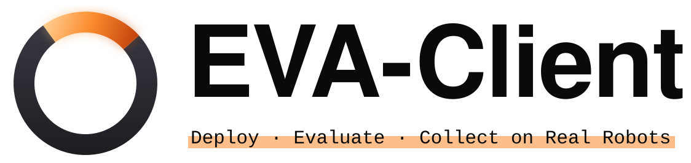
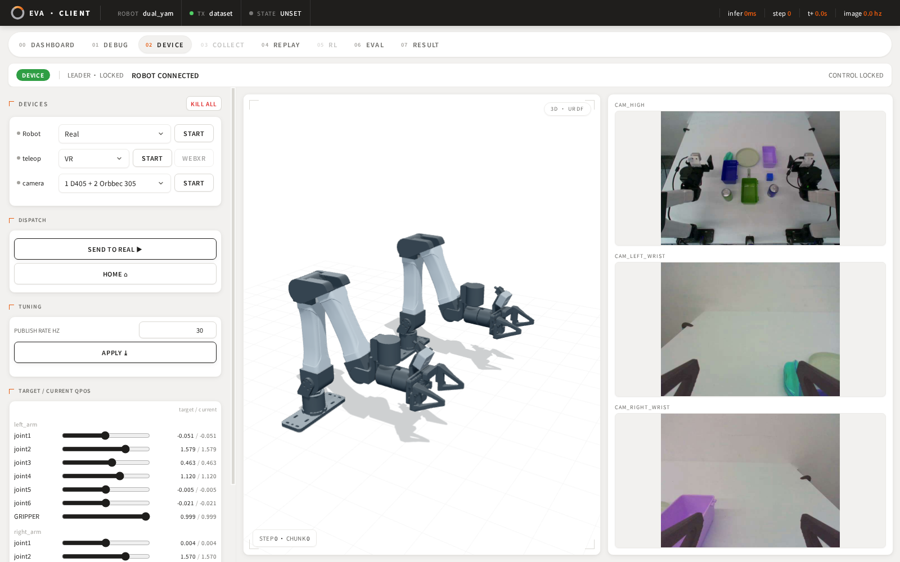
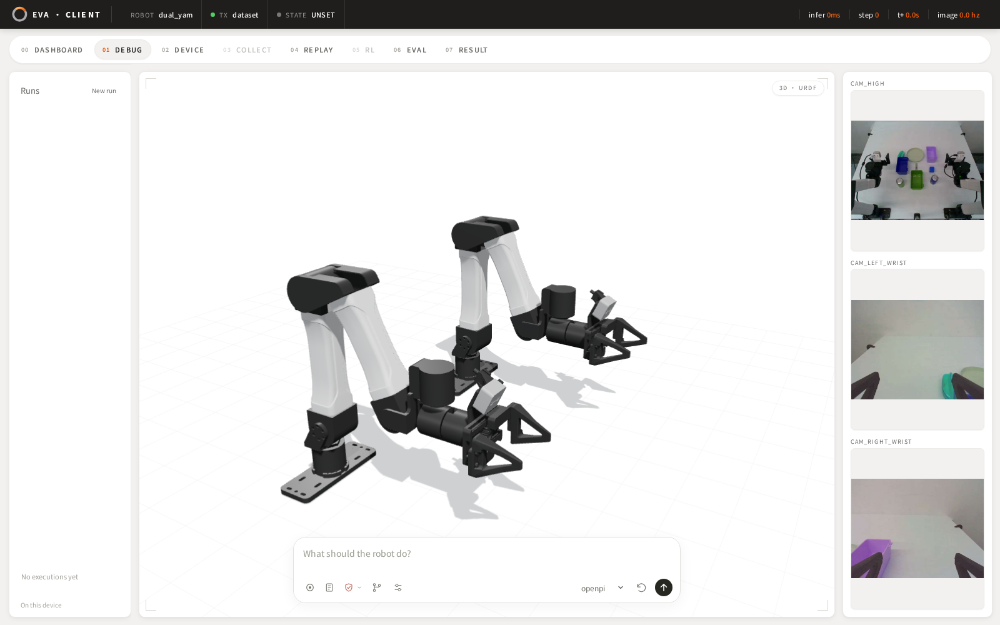
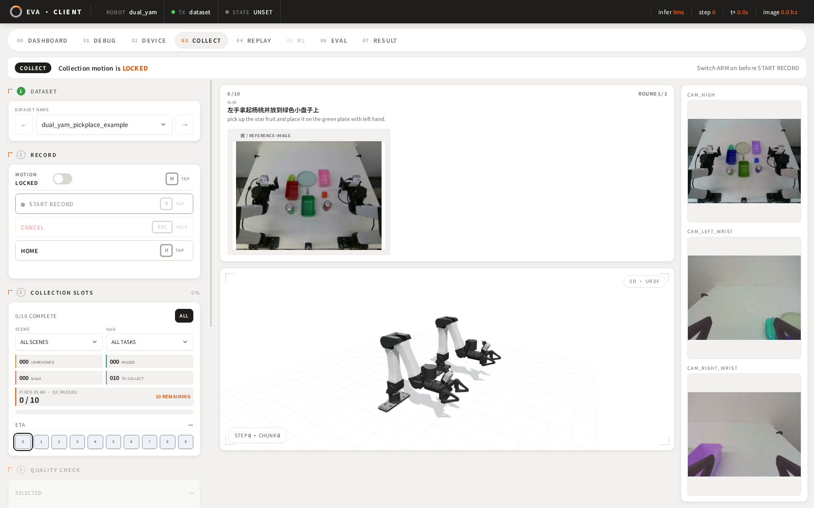
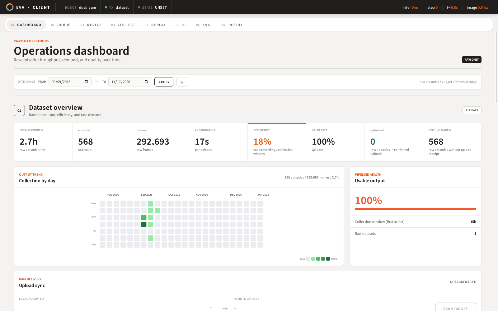
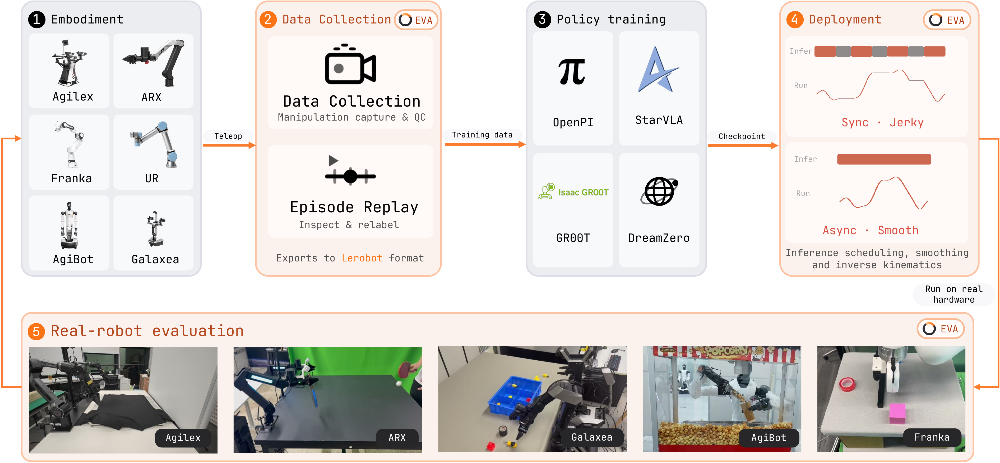

<p align="center">
  <br>
  <a href="https://colalab.net/projects/eva-client/"></a>
  <br>
</p>

<p align="center">
  中文 &nbsp;｜&nbsp; <a href="README.md">English</a>
</p>

<p align="center">

<a href="./LICENSE"></a>
<a href="https://arxiv.org/abs/2607.02646"></a>
<a href="https://github.com/Noietch/EVA-CLIENT/pulls"></a>
<a href="https://github.com/Noietch/EVA-CLIENT/stargazers"></a>
<a href="https://colalab.net/projects/eva-client/"></a>
</p>

<p align="center">
<a href="https://colalab.net/projects/eva-client/docs/introduction.zh.html">📖 中文文档</a> &nbsp;｜&nbsp;
<a href="https://colalab.net/projects/eva-client/docs/introduction.html">📖 English Documentation</a> &nbsp;｜&nbsp;
<a href="https://colalab.net/projects/eva-client/paper/EVA_Client_Report.pdf">📄 技术报告</a> &nbsp;｜&nbsp;
<a href="https://colalab.net/projects/eva-client/">🌐 项目主页</a>
</p>

> ⭐ 如果 EVA-Client 对你有帮助，欢迎点击右上角的 "Star" 按钮支持我们，这是我们持续前进的动力！

## 📝 简介

EVA-Client 是一个面向真机的**部署、评测与数据采集**一体化框架。一套策略，适配任意机器人：调试、录制、评测、可视化，全部在一个浏览器控制台里完成，也可以通过命令行无界面运行。

```bash
git clone https://github.com/Noietch/EVA-CLIENT.git && cd EVA-CLIENT
uv venv --python 3.11 .venv && uv pip install --python .venv/bin/python -e ".[dev]"
.venv/bin/eva --language zh   # 打开 http://127.0.0.1:8080
```

<p align="center">
  <video src="https://github.com/user-attachments/assets/09cf8c98-396d-45d0-bd38-8603412ec3c2" controls muted></video>
</p>

<p align="center"><em>EVA-Client 在浏览器中端到端驱动 AgileX 双臂：遥操作 → 录制 → π₀ checkpoint → 平滑异步部署。真机实拍，并非渲染。</em></p>

## ✨ 核心特性

- **🚀 一键部署**：一个 `.py` 配置即可拉起真机闭环：通信层（[ROS 1](https://github.com/ros/ros) / [ROS 2](https://github.com/ros2/ros2) / [ZeroMQ](https://github.com/zeromq/pyzmq) / 离线数据集）→ 策略后端 → 推理策略（sync / [async](https://github.com/OpenDriveLab/kai0#train-deploy-alignment) / naive / [ACT-ensemble](https://github.com/tonyzhaozh/act) / RTC），并实时补偿推理延迟。
- **🤖 机器人动物园**：开箱支持 8 款机器人，可选关节空间或末端空间（PyRoki IK）控制，在 DEVICE 页一键选择和启动。Fake 模式下无需硬件即可体验全部流程。
- **🧠 多种策略后端**：支持 [OpenPI](https://github.com/Physical-Intelligence/openpi)、[OpenPI-RTC](https://www.pi.website/research/real_time_chunking)、[StarVLA](https://github.com/starVLA/starVLA)、[GR00T](https://github.com/Nvidia/Isaac-GR00T)、[XPolicyLab](https://github.com/XPolicyLab/XPolicyLab)，另有 mock 与 replay 后端用于调试。
- **📊 真机评测**：基于任务集的多 checkpoint 评测，支持里程碑打分和逐次尝试记录。每次 rollout 都会保存相机视频、3D URDF 场景、逐维度状态曲线和里程碑得分，并可在 RESULT 页同步回放。
- **🎥 数据采集**：遥操作（含 WebXR VR 手柄）直接录制为 [LeRobot](https://github.com/huggingface/lerobot) episode，支持后台保存、相机健康检查、页内 QC 回放，可导出为 LeRobot v3.0、MCAP 和 HDF5。
- **🗂️ 采集任务管理**：规划任务与场景，按槽位逐条采集，在 DASHBOARD 上监控产出和质检，然后审核、补采、交付。详见[数据采集 SOP](./docs/zh/data_collection_sop.md)。
- **🔁 强化学习与人在环**：在 RL 工作区中可随时接管策略 rollout，并实时查看价值曲线。
- **🖥️ 无界面控制**：控制台上的每个按钮（包括 HIL 接管）都映射到 ZMQ 控制通道，部署 / 评测 / RL / 采集全流程都可以脱离浏览器运行。
- **🧩 对 Agent 友好**：[`.agents/skills`](.agents/skills) 中内置了多个 coding-agent 技能，用于添加机器人、标定相机和调试机器人 SDK。

## 📊 控制台预览

EVA-Client 自带 Web 控制台，覆盖从设备启动到结果复盘的完整流程。

<table>
  <tr>
    <td align="center">
      
      <p>DEVICE：启动机器人与相机</p>
    </td>
    <td align="center">
      
      <p>DEBUG：实时 3D 场景与策略推理</p>
    </td>
  </tr>
  <tr>
    <td align="center">
      
      <p>COLLECT：按槽位逐条采集</p>
    </td>
    <td align="center">
      
      <p>DASHBOARD：产出与质检总览</p>
    </td>
  </tr>
</table>

八个页面的完整介绍见 [🧭 Web 控制台](./docs/zh/console.md)。

## 🎉 最新动态

- 🔥 **[2026-11-17] EVA-Client 0.3.0：为完整数据闭环重新设计的控制台。** 在一个控制台里完成整场采集：规划任务（可带或不带参考照片），在新的 DEVICE 页启动机器人，带相机健康检查逐槽位采集，在新的 DASHBOARD 上监控产出与质检，然后审核、补采、交付。可参考端到端的[数据采集 SOP](./docs/zh/data_collection_sop.md)。评测现在基于任务集运行，支持里程碑和逐次尝试记录；原生接入 [XPolicyLab](https://github.com/XPolicyLab/XPolicyLab) 策略；coding-agent 技能迁移到 [`.agents/skills`](.agents/skills)。客户端侧的 EVA-SIM 支持已就绪，仿真器即将发布。详见 [CHANGELOG](./CHANGELOG.md)。
- 🔥 **[2026-08-28] EVA-Client 0.2.0。** 新增基于 WebXR 的 VR 手柄遥操作、ARX X5 硬件、双 YAM 主从臂数据采集，支持导出 LeRobot v3.0、MCAP 和 HDF5，并提供添加机器人、标定相机、调试机器人 SDK 的 coding-agent 技能。
- 🔥 **[2026-08-28] EVA-MHS 预览版。** 受 Anthropic [Model Hardware Standard (MHS) 研究预览](https://www.anthropic.com/news/model-hardware-standard-research-preview)启发，EVA-MHS 探索面向机器人的 MHS 风格 agent-硬件接口。其 MCP 服务允许 coding agent 查看运行时状态、调用策略模型并直接控制机器人。EVA-MHS 目前位于 `dev/mcp_preview` 分支，将在后续版本正式发布。
- 🔥 **[2026-07-22] 全新 RL 工作区。** 支持在策略 rollout 过程中进行人在环（HIL）干预，并实时可视化价值曲线。详见 [RL 工作区与 HIL 干预演示](./docs/zh/console.md#rl-and-human-intervention)。

<details><summary>更多历史更新</summary>

- 🔥 **[2026-07-18] 无界面 CLI + ZMQ 控制通道。** 只用一个 `.py` 配置、无需浏览器即可驱动部署 / 评测 / RL / 采集全流程，控制台上的每个按钮（包括 HIL 接管）都映射到 ZMQ socket。详见 [`docs/zh/console.md`](./docs/zh/console.md) 和 [`docs/zh/control-channel.md`](./docs/zh/control-channel.md)。
- 🔥 **[2026-07-03] EVA-Client 正式开源！**
- 🔥 **[2026-07-03] 论文、文档和项目主页上线！** 阅读[技术报告](https://colalab.net/projects/eva-client/paper/EVA_Client_Report.pdf)，浏览[中文文档](https://colalab.net/projects/eva-client/docs/introduction.zh.html)（[English](https://colalab.net/projects/eva-client/docs/introduction.html)），访问[项目主页](https://colalab.net/projects/eva-client/)。

</details>

## 🚀 快速开始

### 安装

需要 **Python 3.11** 和 [uv](https://github.com/astral-sh/uv)。EVA 的运行环境与 `examples/hardware/` 下各硬件 SDK 的环境相互独立。

```bash
git clone https://github.com/Noietch/EVA-CLIENT.git
cd EVA-CLIENT
uv venv --python 3.11 .venv
uv pip install --python .venv/bin/python -e ".[dev]"
```

> 通信层依赖（ROS 1 / ROS 2）、硬件 SDK 和可选依赖请参考[📦 安装指南](./docs/zh/installation.md)。

### 方式一：打开控制台（推荐）

```bash
.venv/bin/eva --language zh    # 英文界面用 --language en
```

浏览器打开 `http://127.0.0.1:8080`。不传 `--config` 时，EVA 会加载默认配置并进入 **DEVICE** 页：选择机器人、遥操作输入、相机以及真机或 fake 模式，然后启动所需组件。

### 方式二：用 Fake 机器人体验（无需硬件）

```bash
.venv/bin/eva device select --robot arx_r5 --camera none
.venv/bin/eva device set robot.mode fake
.venv/bin/eva device start robot
# ... 用完后停止
.venv/bin/eva device stop robot
```

Fake 模式使用共享的 ZMQ fake 节点，无需机器人 SDK 即可提供模拟观测。

### 方式三：运行工作流预设

```bash
# 关节空间部署（DEBUG）
.venv/bin/eva --config configs/01_deploy/dual_agilex_piper/openpi_qpos.py

# 遥操作数据采集（COLLECT）
.venv/bin/eva --config configs/02_collection/dual_yam.py

# 多 checkpoint 评测（EVAL）
.venv/bin/eva --config configs/03_evaluation/dual_agilex_piper_eval.py

# 使用自带样例做离线数据集回放
.venv/bin/eva --config configs/00_openloop/dual_agilex_piper_openloop.py
```

<details><summary><b>💡 提示：</b>远程控制台与策略服务器</summary>

控制台监听 `0.0.0.0:8080`。从本地工作站访问远程 EVA 主机：

```bash
ssh -L 18080:127.0.0.1:8080 '<user>@<eva-host>'   # 然后打开 http://127.0.0.1:18080
```

策略通信使用单独的端口。如果策略服务器在另一台机器的 9000 端口上，先转发端口，再设置 `policy.host="127.0.0.1"`、`policy.port=9000`：

```bash
ssh -N -L 9000:127.0.0.1:9000 '<user>@<policy-host>'
```

</details>

> 预设不会自动启动策略服务器或仿真器，使用前请检查路径、端点和 checkpoint 配置。各机器人的硬件启动方式见[🚀 快速开始指南](./docs/zh/quick-start.md)。

## 🤖 支持的机器人

✅ 已支持 &nbsp;·&nbsp; 🚧 开发中

| 机器人 | 形态 | 状态 |
|-------|------|:----:|
| AgileX Piper | 双 6 自由度机械臂 + 夹爪 | ✅ |
| ARX R5 | 双 6 自由度机械臂 + 夹爪 | ✅ |
| ARX X5 | 双 6 自由度机械臂 + 夹爪 | ✅ |
| Dual Franka Panda | 双 7 自由度机械臂 + 夹爪 | ✅ |
| Galaxea R1 Lite | 躯干上的双 6 自由度机械臂 | ✅ |
| Universal Robots UR5e | 单 6 自由度机械臂 + 夹爪 | ✅ |
| AgiBot G2 | 双臂人形机器人（全身 24 自由度） | ✅ |
| YAM | 双臂主从（follower + leader） | ✅ |
| AgiBot G2（移动底盘） | 移动底盘上的人形机器人 | 🚧 |
| Tianji | 双臂机械臂 | 🚧 |

各机器人的启动脚本和配置说明见 [`examples/hardware/`](./examples/hardware/SUPPOTED_HARDWARE.md)。

## 🔌 通信协议与策略后端

| 层级 | 名称 | 协议 / 数据格式 | 状态 |
|------|------|-----------------|:----:|
| 通信层 | ROS 1 | ROS 1 | ✅ |
| 通信层 | ROS 2 | ROS 2 | ✅ |
| 通信层 | ZeroMQ | ZeroMQ 执行节点 | ✅ |
| 通信层 | 离线数据集 | 离线 LeRobot v2.x 回放 | ✅ |
| 策略后端 | OpenPI | WebSocket + msgpack（OpenPI，无状态） | ✅ |
| 策略后端 | OpenPI-RTC | WebSocket + msgpack（Real-Time Chunking） | ✅ |
| 策略后端 | StarVLA | WebSocket + msgpack（typed envelope） | ✅ |
| 策略后端 | GR00T | ZeroMQ REQ/REP + msgpack-numpy（Isaac-GR00T） | ✅ |
| 策略后端 | XPolicyLab | WebSocket（XPolicyLab 官方协议） | ✅ |
| 策略后端 | Mock | 本地（平滑随机动作） | ✅ |
| 策略后端 | Replay | 本地（回放录制轨迹） | ✅ |

## 🏗️ 系统架构

<p align="center">
  
</p>

## 📚 文档

| 指南 | 内容 |
|------|------|
| [📦 安装](./docs/zh/installation.md) | 环境要求、`uv` 安装、硬件依赖、验证 |
| [🚀 快速开始](./docs/zh/quick-start.md) | 设备启动、工作流预设、远程访问 |
| [🧭 Web 控制台](./docs/zh/console.md) | 八个页面：DASHBOARD、DEBUG、DEVICE、COLLECT、REPLAY、RL、EVAL、RESULT |
| [📚 核心概念](./docs/zh/concepts.md) | 通信层、策略后端、推理策略、机器人、动作空间 |
| [⚙️ 配置系统](./docs/zh/configuration.md) | `_base_` 继承、深度合并、启动流程 |
| [🎞️ 数据录制](./docs/zh/recording.md) | 磁盘目录结构、采集检查、质检、导出与交付 |
| [🧾 数据采集 SOP](./docs/zh/data_collection_sop.md) | 端到端流程：规划、采集、监控、质检、修复、交付 |
| [🗂️ 采集场景规划](./docs/zh/collection_scene_plan.md) | 任务集、场景、物体与采集槽位规划 |
| [🔌 控制通道](./docs/zh/control-channel.md) | 用于部署、评测、RL 和采集的无界面 ZMQ 命令 |
| [🔬 开发指南](./docs/zh/development.md) | 测试、lint、类型检查，以及如何模拟机器人端 |

## 🗺️ 路线图

- [x] **面向 RL 的人在环数据采集。** 将策略 rollout 中的人工干预记录为偏好 / 纠正数据，支持 DAgger 式重标注，并把奖励模型信号通过 LeRobot episode 格式回传，用于在线 RL 微调。
- [ ] **更多机器人。** 扩展到更多本体：双臂机械臂（Tianji 等）、人形机器人以及移动 / 轮式平台。
- [ ] **具身智能体。** 在部署 + 评测闭环外加一层语言驱动的规划器（VLM / VLA + 工具调用），在同一个控制台里端到端地分解、执行、验证并重新规划长程任务。
- [ ] **数据标注。** 为采集模式增加细粒度的任务与子任务标注，把长程 episode 切分为带标签的子任务单元和里程碑，并保存在同一个 LeRobot 数据集中。

## ❤️ 社区与联系

有问题或合作意向，欢迎通过微信联系我们：

<p align="left">
  
</p>

## 👷‍♂️ 参与贡献

欢迎任何形式的贡献！如果想添加机器人、策略后端或新功能，可以先阅读[🔬 开发指南](./docs/zh/development.md)和 [`.agents/skills`](.agents/skills) 中的 coding-agent 技能，然后提交 Pull Request。

感谢所有为 EVA-Client 做出贡献的开发者！

<a href="https://github.com/Noietch/EVA-CLIENT/graphs/contributors">
  
</a>

## 📚 引用

如果 EVA-Client 对你的研究或产品有帮助，请引用：

```bibtex
@misc{yang2026evaclient,
      title={EVA-Client: A Unified Data Collection, Inference, and Deployment Framework for Embodied Policies on Real Robots},
      author={Heqing Yang and Yang Yi and Liyao Wang and Linqing Zhong and Donglin Yang and Ruipu Wu and Zitong Bai and Fengjiao Chen and Manyuan Zhang and Linjiang Huang and Si Liu},
      year={2026},
      eprint={2607.02646},
      archivePrefix={arXiv},
      primaryClass={cs.RO},
      url={https://arxiv.org/abs/2607.02646},
}
```

## ⚖️ 许可证与致谢

本项目基于 [Apache-2.0 许可证](./LICENSE)开源。

EVA-Client 基于多个优秀的开源项目构建，包括用于运动学求解的 [PyRoki](https://github.com/chungmin99/pyroki) 和 [jaxls](https://github.com/brentyi/jaxls)、用于策略服务的 [OpenPI](https://github.com/Physical-Intelligence/openpi)、[LeRobot](https://github.com/huggingface/lerobot) 数据集格式，以及移植自 [MMEngine](https://github.com/open-mmlab/mmengine) 的 mmengine 风格配置系统。
